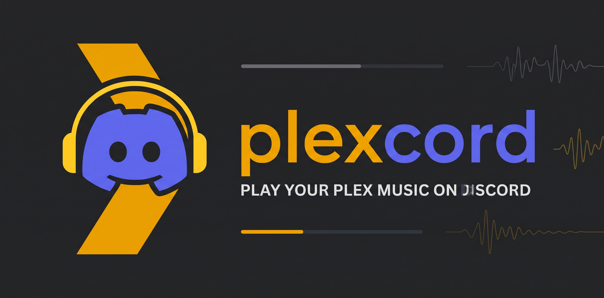

<p align="center">
  
</p>

# Plexcord

[](https://www.python.org/)
[](https://opensource.org/licenses/MIT)
[](compose.yaml)
[](https://discord.com/developers/docs/activities/overview)

**Plexcord** is an ultra-lightweight, zero-external-dependency Discord music bot that streams audio and personal playlists directly from your **Plex Media Server** into Discord voice channels. It includes full support for **Discord Activities (Embedded App SDK)**, **Discord Rich Presence (RPC)** on member profiles, and **Plex Dashboard timeline scrobbling**.

> 🌐 **Multi-language Support**: Plexcord is available in **English** (default) and **Italian**. You can change the server language at any time with `/settings language:it` or directly in the Activity **`⚙️ Config`** tab.
>
> *(🇮🇹 Per gli utenti italiani: la guida rapida e i comandi sono disponibili anche in italiano tramite `/settings language:it`)*.

---

## ✨ Features

- **Dual Operating Modes (`/mode`)**:
  - **🎛️ Activity Mode**: Control playback, browse personal playlists, view the interactive queue, and configure the bot via a modern web interface embedded directly inside your Discord voice channel (or opened as a Web Player).
  - **💬 Slash Commands Mode**: Traditional Discord slash commands (`/play`, `/playlist`, `/queue`, `/now`, `/settings`, etc.) with real-time autocomplete and interactive view buttons.
- **Discord Embedded App SDK & Web Player**:
  - Fully responsive SPA designed for desktop, mobile phones, and Discord voice channel sidebars.
  - **Live Search with Album Artwork**: Search across all enabled music libraries simultaneously by song title or artist name, with instant play (**▶️ Now**) and queue (**➕ Queue**) shortcuts.
  - **🎶 Personal Plex Playlists**: Link your personal Plex account to browse your audio playlists, inspect individual tracks with album covers, and play them instantly (or in **🔀 Shuffle** mode).
  - **Seamless On-the-Fly Volume (0–150%)**: Adjust volume instantly (scaled every 20ms in PCM → Opus) **without stopping, restarting FFmpeg, or seeking the track**.
  - **Interactive Seek**: Click anywhere on the progress bar to seek instantly.
  - **Interactive Queue Management**: Move tracks to the top, play immediately, or remove items from the queue with one click.
- **🟣 Personal Discord Rich Presence (RPC) & 🎧 Plex Scrobbling**:
  - **Personal RPC Status**: With the *"🟣 Activate User RPC"* button, the currently playing track, artist, album art, and live elapsed timer show up directly on **your personal Discord profile** (*"Listening to Plex"*).
  - **Plex Dashboard Multi-User Scrobbling**: When listeners link their personal Plex account via a simple 4-character PIN (`plex.tv/link`), the bot reports playback to the **Plex Dashboard** in real time under each individual listener's username.
- **Voice Channel Control & DJ Role Permissions**:
  - By default, anyone in the bot's voice channel can control playback (`require_voice`).
  - Want restricted control? Enable **`/settings dj_only:True`** (or toggle it in the Activity `⚙️ Config` tab) to restrict playback actions to **Administrators** and an optional **@DJ** role.
- **Intelligent Search & Multi-Library Support**:
  - Concurrent multi-library search with Unicode normalization, accent stripping, punctuation tolerance, and fuzzy matching (`SequenceMatcher`) for minor typos.
- **Ultra-lightweight & Security-First Architecture**:
  - **Zero external services**: No Lavalink, Redis, Node.js, or external database engines. Built with standard library SQLite (`sqlite3`) and minimal Python dependencies (`discord.py[voice]`, `aiohttp`, `defusedxml`).
  - **Docker security**: Runs as a non-root user (`plexcord`, UID `10001`), with read-only root filesystem (`read_only: true`), and tmpfs for `/tmp`.
  - **Token protection**: Plex tokens, Discord client secrets, and internal media URLs are never logged, sent to Discord messages, or leaked to the client browser.

---

## 🚀 1. Create the Discord Application & Bot

1. Open the [Discord Developer Portal](https://discord.com/developers/applications) and click **New Application**.
2. Go to the **Bot** tab:
   - Click **Reset Token** to generate and copy the token. *(Keep it secret! Never commit or share it).*
   - **Privileged Gateway Intents**: You **do not** need privileged intents. *Message Content*, *Server Members*, and *Presence Intent* can remain **disabled**.
3. Go to **OAuth2 → URL Generator**:
   - Select scopes: `bot` and `applications.commands`.
   - Bot permissions: **View Channels**, **Send Messages**, **Connect**, and **Speak**. *(Administrator is NOT required)*.
4. Copy the generated invite link, open it in your browser, and add the bot to your Discord server.

---

## 🐳 2. Quickstart with Docker Compose

Ensure Docker and Compose are installed (e.g., Docker Desktop on Linux/macOS/Windows).

1. Clone the repository:
   ```sh
   git clone https://github.com/P4rz1/plexcord.git
   cd plexcord
   ```

2. Copy `.env.example` to `.env`:
   ```sh
   cp .env.example .env
   ```

3. Open `.env` and set your `DISCORD_TOKEN`:
   ```env
   DISCORD_TOKEN=your_discord_bot_token_here
   # Optional: Set your test guild ID to register slash commands immediately
   DISCORD_GUILD_ID=
   # Optional: Port for Activity & Web Player (default: 8080)
   PLEXCORD_ACTIVITY_PORT=8080
   # Optional: Public HTTPS URL for the Activity (reverse proxy / Cloudflare tunnel)
   PLEXCORD_ACTIVITY_URL=
   # Optional: Discord Client Secret for personal Rich Presence
   DISCORD_CLIENT_SECRET=
   ```

4. Build and start the container:
   ```sh
   docker compose up -d --build
   docker compose logs -f
   ```

---

## ⚙️ 3. Configure Plex from Discord (Activity or Commands)

You can configure your Plex server either via `/plex` slash commands (requires **Manage Server** permission) or through the **`⚙️ Config`** tab in the Discord Activity:

1. **Link your Plex Server**:
   - **From the Activity**: Open the **`⚙️ Config`** tab, click **🔑 Link Server with 4-Digit PIN**, copy the code, and enter it at [plex.tv/link](https://plex.tv/link) (the bot automatically checks every 3 seconds).
   - **From Slash Commands**: Run `/plex login`, open the browser link to authorize, and click **Complete Login**.
2. **Select your Server**:
   - **From the Activity**: Click **🔄 Load Servers**, choose your server from the dropdown, and click **✅ Connect**.
   - **From Slash Commands**: Use `/plex servers` to list them and `/plex server id:SERVER_ID` (with autocomplete).
3. **Music Libraries**:
   - All music libraries are enabled by default. You can toggle them individually in **`⚙️ Config`** or with `/plex library`.

### Manual Plex Server Address (LAN / Docker Network)

If automatic server detection fails (e.g. Plex is behind a NAT or inside a custom Docker network):

```text
/plex address url:http://192.168.1.20:32400
/plex server id:SERVER_ID
```

- When running inside Docker, `localhost` refers to the container itself.
- On Docker Desktop for Windows/macOS, use `http://host.docker.internal:32400`.
- The bot validates the `machineIdentifier` before saving the connection to prevent misconfiguration.

---

## 🎛️ 4. Discord Activity (Embedded App SDK) & Rich Presence

### Developer Portal Activity Setup
1. Expose container port `8080` via HTTPS (using a reverse proxy such as Nginx, Caddy, or Cloudflare Tunnel).
2. In the [Discord Developer Portal](https://discord.com/developers/applications) for your app:
   - Navigate to **Activities → Settings** and toggle **Enable Activities**.
   - Under **Activities → URL Mappings**, map the root path `/` to your public HTTPS domain.
3. *(For Personal Rich Presence on Discord user profiles)*:
   - In the **OAuth2** tab, add a redirect URL (e.g., `https://127.0.0.1`).
   - Copy the **Client Secret** and paste it into the **`🎧 RPC & Account`** tab inside the Activity (or specify `DISCORD_CLIENT_SECRET` in `.env`).
4. In any Discord voice channel, click the **Rocket icon** 🚀 (**Start Activity**) and select your bot!

### Personal Plex Account & Playlists (`🎶 Playlists`)
Every listener in the channel can link their personal Plex account:
1. In the **`🎧 RPC & Account`** tab (or via `/link`), generate a **4-character PIN** and visit [plex.tv/link](https://plex.tv/link).
2. Once connected:
   - Your playback appears in real time on the **Plex Dashboard** with your personal Plex avatar and username.
   - The **`🎶 Playlists`** tab (and `/playlist` command) lets you browse all your personal audio playlists, view track lists with artwork, and play them directly (`▶️ Now`, `🔀 Shuffle`, `➕ Queue`).

---

## 📜 5. Slash Commands Reference

| Command | Description |
| --- | --- |
| `/mode [mode]` | Switch between **Activity Mode** (`activity`) and **Slash Commands Mode** (`commands`) |
| `/activity` | Launch the Discord Activity in your current voice channel or open the Web Player |
| `/play query [library]` | Search for a track by title or artist (with autocomplete) and add it to the queue |
| `/playlist [id] [shuffle]` | Browse and play playlists from your connected personal Plex account |
| `/link` | Link your personal Plex account via a 4-character PIN code (`plex.tv/link`) |
| `/unlink` | Unlink your personal Plex account from your Discord user profile |
| `/queue [page]` | View current track, upcoming tracks (10 per page), and player controls |
| `/now` | Display the currently playing track with elapsed time and control buttons |
| `/pause`, `/resume`, `/skip` | Instant playback controls |
| `/shuffle` | Shuffle the remaining tracks in the queue |
| `/stop` | Stop playback and clear the queue |
| `/leave` | Stop playback, clear the queue, and immediately disconnect from the voice channel |
| `/plex login`, `/plex logout` | Authenticate or disconnect the server's primary Plex Media Server |
| `/plex servers`, `/plex server id` | List available Plex servers and select the active server |
| `/plex address [url]` | Set a manual LAN/Docker address or reset to automatic detection |
| `/plex libraries`, `/plex library`, `/plex all` | Manage enabled music libraries |
| `/settings [volume] [bitrate] [idle_seconds] [max_queue] [dj_only] [dj_role] [clear_dj] [language]` | Configure volume (0–150%), Opus bitrate, idle timeout, queue limit, DJ controls, and language (`en`/`it`) |
| `/help` | Quick help and commands overview |

---

## 🔒 Security & Persistence

- **Data Persistence**: All settings, user links, and Plex tokens are persisted in an SQLite database located in `/app/data/plexcord.db` backed by the Docker volume `plexcord-data`.
- **Token Protection**: Plex auth tokens and internal streaming URLs are never sent to Discord channels or exposed to browser clients. Album art is proxied securely by the bot, and FFmpeg receives credentials solely through HTTP headers (`-headers`).
- **Permissions**: Runs under an isolated unprivileged user (`UID 10001`) with read-only root filesystem and dropped capabilities.

---

## 🛠️ Development & Local Testing

To run the unit test suite locally without Docker:

```sh
python -m venv .venv
source .venv/bin/activate  # On Windows: .venv\Scripts\activate
pip install -r requirements.txt
python -m unittest discover -s tests -v
```

For guidelines on repository architecture, design invariants, and AI-assisted workflows, refer to [`AGENTS.md`](AGENTS.md).

---

## 📄 License

This project is open-source under the [MIT License](LICENSE).
